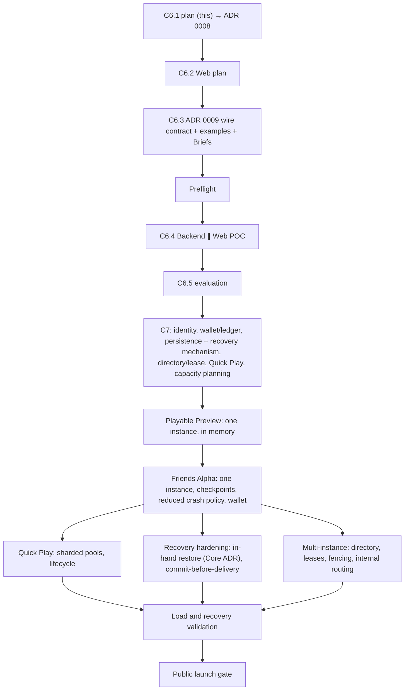

# M8 C6.1 — Backend/API Architecture Plan

**Status:** **Approved** by the Product Owner on 2026-11-11 (revision 4, with the clarifications recorded in §17). [ADR 0008](../adr/0008-fastapi-server-and-single-writer-tables.md) records the durable decisions; it was accepted on 2026-11-11, which completed C6.1. The wire protocol is left to ADR 0009 (C6.3). Nothing here is implemented.

> **Everything about scaling, routing, matchmaking and recovery below is a proposed design, not an implemented or tested guarantee.** Only the [POC] items are built in C6.4. The [Later] designs are confirmed or changed in C7 and in later milestones. The [Launch] requirements are proven by tests before a public launch.

Tags:
- **[POC]**: built in C6.4.
- **[Later]**: designed now, implemented later.
- **[Launch]**: mandatory and tested before a public launch.

## 1. Current state

| Area | Implemented | Source |
| --- | --- | --- |
| Engine (`core/`, `game/`) | complete NLHE 2–9; frozen per-viewer projection; immutable hand history; production shuffles use `SystemRandom`, and the only seeding seam is test-only | `ARCHITECTURE.md` |
| Application | `TableSession`: synchronous and in memory; members, seats, host, intents, pre-actions, shared revision, hand boundary, generation reset | ADR 0005 §6–11, ADR 0006 |
| Server | none | — |
| Persistence | none; the engine has no serialization (ADR 0005 §14) | — |

**Product scope:**
- Friends Alpha is private tables only; Quick Play and multi-tabling are deferred (Contract §9).
- D13: matchmaking will share the private-table model.
- Crash and restart must preserve account, wallet and table data (Contract §7, §10).

## 2. Framework: FastAPI + uvicorn (accepted direction)

FastAPI is built on Starlette, so WebSocket handling is identical. It adds pydantic validation, dependency-injected auth, OpenAPI for HTTP, and JSON Schema export for every wire message.

There are two rules:

1. **Explicit mapping into DTOs.** Wire DTOs are built from frozen per-viewer views by explicit field-by-field functions, an allowlist. Automatic bulk copying from domain or view objects (`model_validate(view)`, `from_attributes`, `asdict`, `__dict__`) is prohibited, because it would bypass the allowlist. Normal pydantic validation of the explicitly mapped data is permitted.
2. **`async def` network handlers.** A plain `def` handler would run in a thread pool. `async def` alone does not serialize table mutations: `TableRuntime` and its synchronous transition boundary guarantee that (§8).

[**ADR 0008**](../adr/0008-fastapi-server-and-single-writer-tables.md) (accepted 2026-11-11) lists clause by clause what it supersedes in ADR 0005. In summary:
- the §14 framework clause is superseded;
- the §12 single-instance and restart-loss clauses are superseded by "one authoritative writer per table; one instance until a later ADR; restart loss only through Playable Preview";
- the §14 serializer clause is refined to explicit mapping into DTOs.

The wire contract becomes ADR 0009 in C6.3.

## 3. Logical boundaries and what C6.4 actually builds

These are the architecture's logical boundaries. **C6.4 builds code for the first two and a dictionary.** The rest stay on paper until a milestone needs them. No boundary becomes a service or an abstract interface before it has a second implementation.

| Boundary | Responsibility | C6.4 [POC] | Later |
| --- | --- | --- | --- |
| Transport | HTTP and WebSocket, auth (token → `UserId`), DTO mapping, connection outboxes, frame-size limit | built | a gateway tier that routes internally (§4) |
| Table Runtime | the single writer of one table: wraps one `TableSession`, runs commands one at a time, emits per-recipient messages, owns the next-hand timer, isolates its own failure | built (one class) | a durable commit step, checkpoints, lease checks (§5) |
| Table Directory | `table_id` → runtime; code → `table_id` | a dictionary in the app state | a shared store with leases and placement |
| Matchmaking | Quick Play tickets and seating | none | §6 |
| Capacity | admission and placement | none, beyond the frame-size limit | per-instance limits, placement, shedding |
| Persistence and recovery | durable table state, ledger, restore | none (state is in memory) | §5 |

**Dependency direction:**
- transport → runtime → `app` → `game` → `core`.
- Matchmaking and capacity, later, reach a table only through runtime commands, never a `TableSession` directly.

**Followed in the POC because they are cheap now:**
1. All table mutations go through `TableRuntime.execute(command)`. Read-only queries use a separate, controlled read interface that never mutates. Commands are a small, closed set of frozen values; no generic command framework is built (E13).
2. Commands are plain data values.
3. Every table-bound message is addressed by `table_id`.
4. Ids are globally unique (UUIDs).
5. Each table has isolated authoritative gameplay state. Shared identity, wallet and bankroll systems are separate cross-table concerns for later milestones.

These keep the [Later] designs possible. They do not make them work.

## 4. Scaling path [Later, proposed]

| Concern | Proposed design |
| --- | --- |
| Table ownership | one owner instance per table, held as a **lease** in the shared directory |
| Client routing | **internal to the backend.** Clients use one public endpoint. A gateway tier terminates WebSockets and forwards each table-bound command to the owner instance over an internal channel, and carries that table's messages back. The `table_id` in the protocol is only an address; clients never learn instance addresses, and an owner change does not have to drop client connections |
| Failover | the lease expires; a new owner takes over with a higher **epoch**, restores the table (§5), and resumes. The gateway re-points, and clients either keep their connection and receive a fresh snapshot, or reconnect |
| CPU | scale by processes and hosts, spreading tables across them. Python's GIL limits each process to one core |
| Unchanged in principle | poker rules (Core) and the `TableSession` command semantics. **Recovery does require additions** to `TableSession` and, for public-grade recovery, probably to Core (§5) |

## 5. State, deadlines, recovery, leases and fencing [Later, proposed]

These are five separate concepts. Each one answers a different question, and none substitutes for another.

| Concept | Question it answers | Proposed design |
| --- | --- | --- |
| Authoritative state | what the table *is* | every session and engine fact needed to continue: members, seats, stacks, intents, pre-actions, host, revision, the hand in progress, and the deck order |
| Durable commit | when a transition counts | **commit before delivery.** A transition is durable before any client sees its snapshot. A lost transition was therefore never observed, and no revision visible to a client ever goes backwards |
| Deadlines | when time acts | next-hand, action and disconnect deadlines are stored with the state as absolute times plus the revision they belong to. On restore they are re-armed, and an expired one fires at once and passes the revision check. A deadline alone restores nothing |
| Lease | who may write now | a time-limited ownership record per table in the shared directory |
| Fencing | how a stale owner is stopped | every durable write carries the lease epoch, and the store rejects any write with an older epoch. A paused former owner can never commit after a takeover |

### Recovery gaps (evidence-based; none is solved today)

| Layer | Gap | Why it matters |
| --- | --- | --- |
| Core | No serialization of the hand in progress (`PokerHand`, `BettingState`, `Showdown`, history), and no production way to rebuild a hand from a recorded deck order (`Deck.shuffle(_rng=...)` is test-only by rule) | an accurate in-hand restore needs one of: a state export and import, or a deterministic replay of commands over a recorded deck order. **Either is a Core change that needs an ADR** |
| Core | The deck order is secret state | storing it durably needs encryption at rest and access control |
| Application | No export or `restore` of `TableSession` (members, names, seats, statuses, intents, pre-actions, host, departed set, waiting flag, settings, revision) | restore needs it; the revision must continue from the stored value (L5, L6) |
| Application | Hand numbers restart on a generation reset (L9) | idempotent records need a durable, table-wide hand id |
| Server | Tokens and directory records exist only in memory | they need durable, hashed tokens |
| Consistency | Commands and their snapshots are not tied to a durable commit | without commit-before-delivery, a crash can roll back chip movements clients have already seen |
| Idempotency | No durable record of which commands were applied | a client retrying after a crash must get `STALE_REVISION` for a committed command and a fresh application for an uncommitted one. Ledger entries need idempotency keys (table, session, hand id, member, kind) so that a replay never pays out twice |

### Recovery policy (E16)

**Public product:**
- An accurate in-hand restore. No accepted chip movement is lost and no award is duplicated.
- This needs commit-before-delivery, a Core restore capability (export and import, or replay over a recorded deck), and an idempotent ledger.
- C7 chooses the mechanism. Tests prove it before launch.

**Friends Alpha, approved reduced policy (E16), explicit to players.** It is permitted only once the durable state and ledger consistency below are implemented and tested. Until then, no rollback or recovery support is claimed.
- **Checkpoints at hand boundaries.** Settlement, buy-ins and cash-outs are committed atomically with their ledger entries. Completed hands are never undone.
- **A hand in progress at a crash is voided.** Every participant's stack returns to its hand-start value. A "hand voided" record is written and nothing is awarded.
- **Bankroll stays consistent:** the wallet moves only at buy-in and cash-out, and the table total equals the hand-start total.
- **Expected changes:** `TableSession` export and restore, plus the durable hand id. No Core change is expected for this policy, but that is to be confirmed in C7.

## 6. Quick Play [Later, proposed]

**Pool key:** variant, betting structure, stakes, seat count, buy-in range, action timer. A user has at most one active ticket and at most one Quick Play seat (multi-tabling is deferred).

**Partitioning, so that one writer does not bottleneck a popular pool:**
- A pool is split into **K shards**. Each shard is a single writer over its own tickets and a disjoint set of the pool's tables.
- A stateless front assigns each arriving ticket to a shard, weighted by free capacity and queue length.
- K = 1 for quiet pools. K grows with load, and shards are split or merged at quiet points.
- A low-rate rebalance step pairs leftover single waiters across shards, so nobody is stranded alone in one shard.
- Correctness never depends on the shard view, because the table's runtime is the seat authority.

**Flow when thousands request at once:**
1. **Admission:** rate limits per user and per IP; `429` with retry-after.
2. **Idempotent ticket:** the idempotency key returns the same ticket; an active ticket is returned instead of a second one.
3. **Batch allocation per shard tick:** fill suitable existing tables first. A table is suitable when it is in the same pool, has a free seat, is not closing, and is not barred by the 30-minute anti-ratholing claim (D36). Only when at least two tickets are waiting and the shard has no capacity is a new table placed.
4. **Atomic seat:** only the table's runtime seats players, and the engine rejects an occupied seat. A rejection updates the shard's cache, and allocation retries elsewhere. With the wallet, later: the buy-in debit is keyed by the ticket id before the join, and refunded if the join fails.
5. **Duplicates and cancellation:** the shard writer orders them. A cancel after seating reports `seated`.
6. **Exhaustion:** a bounded queue and a maximum wait; beyond either, `capacity_exhausted` with retry-after. Nothing is overcommitted. A waiting player who disconnects has the ticket cancelled after a grace period.

**Table balancing (E15):**
- Fill suitable existing tables first.
- **Never** move an active player or interrupt a hand to consolidate tables.
- Optional consolidation may come later, only at hand boundaries (a product decision then).

**Empty-table lifecycle (Quick Play):**

| State | Entered when | Behavior |
| --- | --- | --- |
| `OPEN` | the table is created for two or more tickets | playing, with free seats offered to the shard |
| `FULL` | every seat is held | not offered; returns to `OPEN` when a seat is released |
| `SHORT` | fewer than two players are able to play | no hand starts; the table is **preferred** for the next ticket; seated players see "waiting for players". **Never closed because only one seated player remains** |
| `DRAINING` | no seated player remains, or the instance is shutting down | no new seats; a hand in progress settles first (hand-safe); seats held under the Contract §6 sit-out and reclaim timers still count as occupied |
| `CLOSED` | the table has been **completely empty** for a configurable grace period after `DRAINING` (initially 60 s, approved in E15) | released from the directory and capacity; stakes reconciled. A Quick Play table is never reopened; new tables are created on demand |

Private tables keep the Contract §6 lifecycle (a 10-minute empty-session timeout, and reopening creates a new session and code).

## 7. TableSession limitations (no refactor now)

| # | Limitation | Matters for | Expected change |
| --- | --- | --- | --- |
| L1 | no query for a non-member | seat picker, spectators, directory capacity, matchmaking | an additive query |
| L2 | `join` needs a revision a non-member does not have | joins | the server passes `session.revision` in C6.4 only; **Friends Alpha must show available seats before the player chooses one** (E4, Contract §2), through L1 |
| L3 | one fixed buy-in per table | Contract §4, Quick Play ranges | a buy-in amount with the wallet (C7) |
| L4 | no rebuy or top-up | Contract §4 | additive commands at the hand boundary (C7) |
| L5 | no export or restore | recovery | export and restore, plus Core support for an in-hand restore (§5) |
| L6 | the revision exists only in memory | recovery | stored, and continued after a restore |
| L7 | a defect fails the session with no rollback | uptime | runtime isolation [POC]; restore later |
| L8 | synchronous projection of every member's view per transition | density, latency | measure first, then scale by processes |
| L9 | hand numbers restart on a generation reset | ledger idempotency | a durable table-wide hand id |
| L10 | host versus Table Owner | configuration rights | C7 |

None blocks C6.4.

## 8. Concurrency model [POC]

**Phase 1** is synchronous, inside `TableRuntime.execute`, on the event loop:
1. Run the command.
2. Map each captured view to an immutable DTO message at its revision.
3. Put the messages on each recipient's outbox with a non-blocking put, in transition order. A rejection goes only to the requester.
4. Update the registry and the timer.

Phase 1 contains no `await`, so commands are serialized with no lock.

**Phase 2:** one writer task per connection drains its FIFO outbox and sends.

**Guarantees:**
- per-client revision order;
- snapshots exactly as they were captured;
- connecting creates no gap, because attaching, superseding and the first snapshot happen in one phase-1 step;
- bounded outboxes: an overflowing connection is closed, and a reconnect returns a snapshot;
- per-table failure isolation.

**State transitions versus animation pacing (E7).** The server captures and sends the genuine intermediate states: one snapshot per shared transition, in revision order. How fast a client animates them is the client's concern. A client may pace or animate them, but never reorder or alter them. The server never delays or merges transitions for presentation.

**Slow-client policy.** Each outbox is bounded. A client that fills it is disconnected and its queued messages are dropped. On reconnect it receives the current snapshot. Other clients are never delayed.

**[Later]:** a durable commit is inserted between steps 1 and 3 (commit before delivery, §5). It is a separate design point, because it adds I/O to the write path.

## 9. Wire, errors and hidden information [POC]

**Endpoints:**
- `POST /tables`: create → `{table_id, code, token}`.
- `POST /tables/by-code/{code}/members`: join → `{table_id, token}`.
- `GET /health`.
- `WS /ws/tables/{table_id}`: the `table_id` is an address; routing stays internal (§4). Messages: `hello {protocol, token}`, `command {request_id, expected_revision, name, args}`, `snapshot {revision, cause, view}`, `rejected`, `error`, `left_table`, `table_failed`, `superseded`.

**Errors:** protocol errors give `error`; argument errors give `error` and keep the connection; an authentication failure closes the connection; domain rejections give `rejected` to the requester; a defect fails the table.

**Identities (E12).** These are separate concepts:
- the **permanent table id**, a UUID;
- the **rotating join code**, an invitation;
- the **player identity**, `UserId`;
- **game-node ownership**, internal and never exposed.

Join codes never collide among active codes. A revoked code, or a code from a closed session, never grants access. In C6.4 each table gets one code that is unique among active codes. Rotation and revocation come later, with the Owner role (Contract §3).

**Idempotency** comes from the revision. **Reconnect** returns the current snapshot only.

**Hidden information:**
- Only `TableView` values reach the wire, through explicit mapping.
- A view goes only to its own user's connection.
- Hidden cards are `null`.
- Tokens, `UserId`, `player_id`, the deck and burned cards never appear on the wire.
- The token travels in the first frame, never in a URL or cookie.

## 10. POC, Later and Launch

| Item | [POC] | [Later] | [Launch] |
| --- | --- | --- | --- |
| FastAPI transport, DTO mapping, JSON Schema | ✓ | | |
| `TableRuntime` single writer, data commands, `table_id` addressing, UUIDs | ✓ | | |
| Next-hand timer, reconnect by token, supersede, failure isolation | ✓ | | |
| Backend ∥ Web, two-browser demonstration | ✓ | | |
| Seat summary (L1), spectators, action and disconnect timers | | ✓ | |
| Wallet, ledger, buy-in choice, rebuy and top-up | | ✓ (C7, Friends Alpha) | |
| Durable checkpoints, restore, Friends Alpha reduced crash policy | | ✓ (Friends Alpha) | |
| Accurate in-hand restore with commit-before-delivery | | ✓ | ✓ tested |
| Quick Play: sharded pools, lifecycle | | ✓ (after Friends Alpha) | ✓ tested |
| Shared directory, leases, fencing, internal routing | | ✓ | ✓ tested |
| Load, spike, soak, failover; monitoring and runbook; capacity plan | | | ✓ |

## 11. Launch readiness [Launch]

**10,000 simultaneous connections is the first proposed load-test milestone.** It is not the architecture's maximum and not a capacity claim; nothing has been measured. Capacity planning in C7 and later approves the final SLOs, spike targets and tested capacity.

| Dimension | Proposed first measurement milestone (to be confirmed) |
| --- | --- |
| Connections | 10,000 simultaneous connections on at least two instances; record each instance's limit |
| Active tables | record the number of tables per instance at that load; propose a tables target at capacity planning |
| Action latency | measure phase 1 p99, end-to-end p95 and p99, and event-loop lag; SLO candidates are phase 1 ≤ 20 ms and end-to-end p95 ≤ 150 ms |
| Matchmaking latency | measure request-to-seat p95 and p99 with capacity available and with a new table needed |
| Correctness under faults | 0 double seats, duplicate tickets or duplicate awards (a fixed requirement, not a target) |
| Recovery | measure restore time after an instance crash; 0 loss of committed transitions and ledger entries (fixed); the in-hand policy per E16 |
| Load spike | a defined multiple of baseline arrival rate: only explicit shedding, no instance loss |
| Headroom | measured headroom at forecast peak, N+1 instances, a tested scaling runbook |
| Soak | 24 h with no memory or queue growth trend |
| Monitoring | metrics, alerts and dashboards for connections, tables, latency, outbox depth, matchmaking wait, shedding, leases and errors; the recovery runbook exercised |

Load clients come from bots and simulation (roadmap Milestone 10).

## 12. C6.4 slice [POC]

| | Backend Cycle | Web Cycle |
| --- | --- | --- |
| Paths | `src/go_poker/server/`, `tests/server/` | `web/` |
| Builds | FastAPI app factory, transport, `TableRuntime`, a table dictionary, DTOs and JSON Schema, next-hand timer, reconnect and supersede, failure isolation | connection and `hello`, snapshot store, create and join, a functional table, error display |
| Against | ADR 0009, the example messages, `TableSession` unchanged | ADR 0009, the example messages (mock server) |

- **Not in C6.4:** matchmaking, capacity placement, persistence, leases, more than one instance, the seat summary, spectators, other timers, and any change to Core or `app/`.
- **Integration:** Backend merges first, then Web after the pre-merge update. The Backend's two-client integration test runs on `master`, and the two-browser demonstration is recorded for C6.5.

## 13. Preflight before C6.4

One bounded Meta task on the Small-Change Path. No ownership change is needed: `scripts/check_ownership.py` runs path checks only in `multi-lane` mode.

| Change | Why it is needed |
| --- | --- |
| `fastapi`, `uvicorn`, `websockets`; dev `httpx`. Kept out of the engine as an optional extra or dependency group that the dev environment includes | the server cannot run or be tested without them |
| Python 3.14 check, including the `pydantic-core` wheel | ADR 0005 §14 |
| Web manifest and lockfile; typecheck, test and build in `verify.py`; Node in CI | one verification gate (ADR 0005 Consequences) |

## 14. Tests

**[POC]:**
- DTO mapping tests against the example messages.
- Parser tests.
- A two-client FastAPI `TestClient` integration test with the real `TableSession` and engine.
- A wire leak test on every message for each viewer.
- Race, reconnect and supersede, isolation and fault tests.
- Web store and rendering tests against the example messages.

**[Later]:**
- Matchmaking property tests.
- Export and restore round-trip tests.
- Crash at every point of the commit path.
- Lease and fencing tests.

**[Launch]:** the §11 suite on production-like infrastructure.

## 15. Roadmap dependencies (approved, E18)

C6.4 scope is unchanged.

## 16. Risks

| Risk | Mitigation |
| --- | --- |
| Automatic DTO construction leaks hidden facts | explicit mapping; a Reviewer check; the wire leak test |
| A blocking call, or an `await`, inside the `TableRuntime` transition boundary | the boundary is synchronous by design; a Reviewer check; event-loop-lag metric; the race test |
| In-hand recovery needs Core changes larger than expected | C7 chooses the mechanism by ADR; Friends Alpha uses the explicit reduced policy |
| Commit-before-delivery adds latency | measured in recovery hardening; group commits if needed |
| Split-brain in failover | lease plus epoch fencing, tested before launch |
| A hot Quick Play pool | K shards and rebalancing |
| The Web side starts before the design system | a functional UI; the presentation layer is replaceable |

## 17. Decision record (approved 2026-11-11)

E1–E8 decision text is quoted exactly from revision 1. Every decision below was approved by the Product Owner on 2026-11-11 unless it is marked Deferred or Withdrawn. The Owner's clarifications are part of each decision.

| # | Decision | Outcome | Approved direction, with clarifications |
| --- | --- | --- | --- |
| E1 | Server framework | Approved | FastAPI + uvicorn; ADR 0008 supersedes the ADR 0005 §14 framework clause |
| E2 | Add the server dependencies, and map `src/go_poker/server/` and `tests/server/` to the Backend lane | Approved as recommended | dependencies only (`fastapi`, `uvicorn`, `websockets`, dev `httpx`), in the bounded preflight; no path mapping |
| E3 | Product rule: a timeout at a showdown decision | Deferred | decided with the action timer |
| E4 | POC join with no pre-join view (the server supplies the revision) | Approved, **for C6.4 only** | Friends Alpha must show available seats before the player chooses one (Contract §2) |
| E5 | Host (implemented) versus Table Owner (Contract) | Deferred (C7) | the POC keeps the host |
| E6 | Contract §12 delegates the real-time protocol and framework to C7 | Approved as recommended | ADR 0009 is protocol v1; C7 confirms or supersedes it |
| E7 | Send every transition, or only the final state per command | Approved | ordered snapshots per transition carrying genuine intermediate states, in revision order; client animation pacing is separate from server transitions; bounded queues per connection with a slow-client policy (§8) |
| E8 | Core task size: `turn_timeout_action` is small | Withdrawn | superseded by E9 |
| E9 | The POC split for C6.4 | Approved | Backend ∥ Web, kept small and local |
| E9-A | Amend the M8 Plan: C6.3's two Briefs, C6.4 and exit gate 5 from "Core and Backend" to "Backend and Web", and add the preflight step | Approved as recommended | recorded in the M8 Plan |
| E10 | The Web toolchain in the same preflight | Approved as recommended | tools chosen in C6.2; one bounded preflight |
| E11 | ADR 0008 scope | Approved | ADR 0008 accepted 2026-11-11, with the Owner's clarifications on handlers, DTO mapping and table state isolation |
| E12 | Table-scoped addressing and global UUIDs | Approved | permanent table id plus rotating join code; table identity, invitation code, player identity and game-node ownership are separate; join codes never collide among active codes; revoked codes never grant access; routing internal (§4, §9) |
| E13 | Commands as data values through one `execute` per table | Approved | all mutations through `TableRuntime.execute(command)`; read-only queries through a separate controlled interface; no generic command framework |
| E14 | Quick Play pool key and limits | Approved direction; details deferred to Quick Play design | grouping by variant, stakes and table configuration; partitioned matchmaking (§6) |
| E15 | Quick Play table balancing | Approved | prefer suitable existing tables; a **completely empty** table may close after a configurable grace period, initially 60 s; never close a table only because one seated player remains; no forced mid-hand transfers; consolidation deferred |
| E16 | Crash recovery | Approved | the public product requires full in-progress recovery; Friends Alpha may void interrupted hands and restore hand-start stacks **only when durable state and ledger consistency are implemented and tested**; the mechanism is decided in C7 |
| E17 | Launch readiness | Approved | 10,000 concurrent connections is an initial load-test milestone, not a capacity claim or architectural limit; final capacity targets come from measurement |
| E18 | Roadmap dependencies | Approved as recommended | §15, recorded in `ROADMAP.md` and the M8 Plan |

## 18. Outcome and closeout

- **Recorded in:**
  - this plan;
  - [ADR 0008](../adr/0008-fastapi-server-and-single-writer-tables.md), proposed;
  - the [M8 Plan](M8_PLAN.md): C6.3, the preflight, C6.4, C7 and exit gate 5;
  - `ROADMAP.md`: approved decisions of 2026-11-11, the server line, the sequence;
  - `CURRENT_CYCLE.md`;
  - the [Friends Alpha Product Contract](../product/FRIENDS_ALPHA_PRODUCT_CONTRACT.md) §7, for the E16 Friends Alpha policy.
- **Planned, not implemented:** every scaling, routing, matchmaking and recovery mechanism in §4–§6.
- **Closed on 2026-11-11:** ADR 0008 accepted; ADR 0005's status line records the partial supersession; C6.1 marked complete in `CURRENT_CYCLE.md`. The Owner commits through `/finish-cycle`.
- **Next:** C6.2, the Web plan, starts only on the Owner's instruction.
