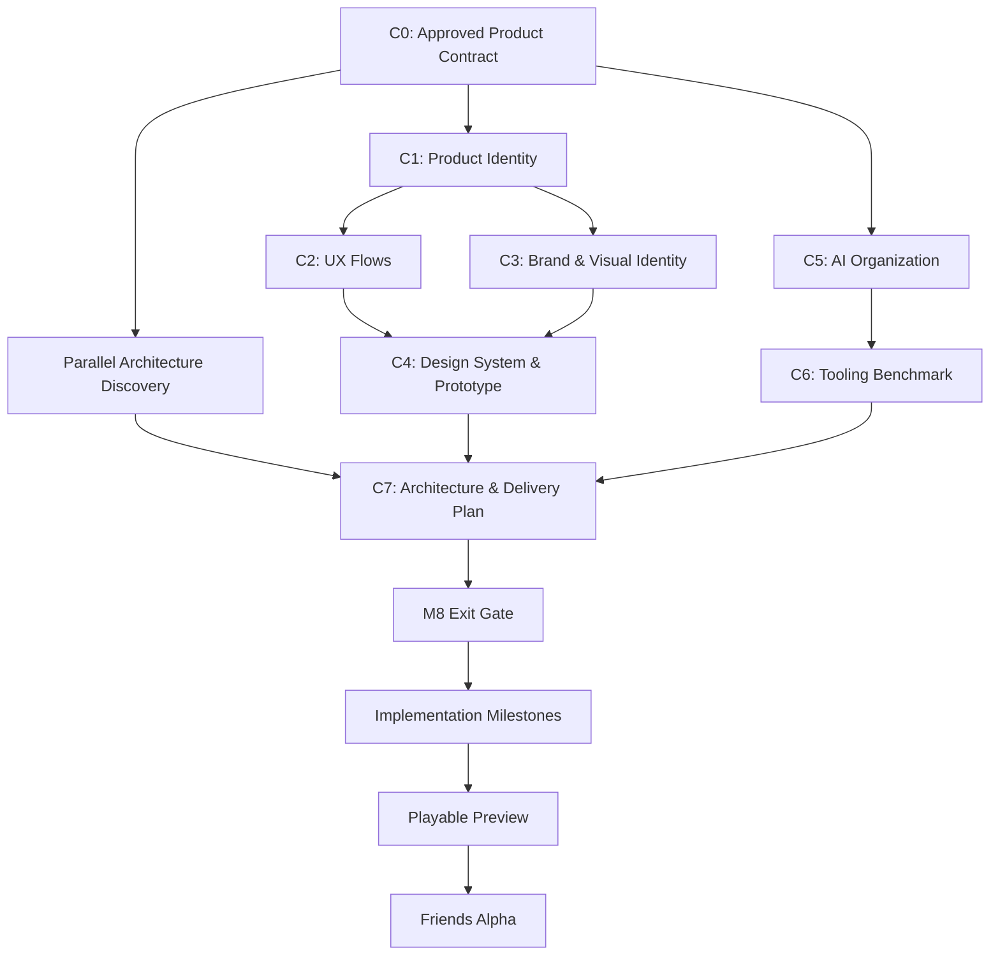

# Go! Poker — Milestone 8 Plan

**Status:** Plan approved in M8 C0. Cycle status is in `docs/CURRENT_CYCLE.md`.  
**Date:** 2026-11-08  
**Milestone:** M8 — Go! Product & Company Foundation

## Outcome and boundaries

M8 defines the product/design identity, cross-platform experience contracts, AI-native team operating model, tooling benchmarks, and technical delivery architecture. **M8 is not the Friends Alpha release.** The next implementation milestones deliver Playable Preview and Friends Alpha in slices of the same product.

The authoritative Friends Alpha scope and decisions are in `docs/product/FRIENDS_ALPHA_PRODUCT_CONTRACT.md`.

## Cycles and deliverables

| Cycle | Purpose | Completion artifact |
|---|---|---|
| C0 | Freeze product behavior, Alpha scope, acceptance and dependency map | Friends Alpha Product Contract + this M8 Plan |
| C1 | Product positioning, audience, core experience and Go! master-brand relationship | `docs/product/PRODUCT_VISION.md` |
| C2 | Lobby, saved table, joining, wallet, seating, game and error/reconnect UX flows | `docs/product/UX_FLOWS.md` |
| C3 | Visual brand directions, logo/wordmark selection, typography and table/motion art direction | `docs/design/BRAND.md` and visual references |
| C4 | Cross-platform design tokens, component states, motion specifications and interactive prototype | `docs/design/DESIGN_SYSTEM.md`, `docs/design/MOTION_CONTRACTS.md`, prototype |
| C5 | AI org structure: Lead, Core, Backend, Web, Product, QA/Reviewer; task contracts, escalation and budgets | `docs/organization/AI_ORGANIZATION.md` |
| C6 | Evidence-based agent orchestration benchmark (lean Claude workflow, Paperclip/hybrid, alternatives as justified) | `docs/organization/TOOLING_EVALUATION.md`, delegated pilot findings |
| C7 | Integrate product/design/org with identity, wallet, ledger, sessions, API, hosting, security, operational tradeoffs | Architecture ADRs + next milestone execution plan |

## Dependency graph

C1 unlocks parallel UX (C2) and visual identity (C3). The AI organization (C5→C6) and initial technical investigation proceed independently of visual design. Only the integrated final architecture/delivery cycle (C7) waits for those inputs.

## M8 exit gates

1. Product vision, scope and approved contract provide sufficient detail to develop without recurrent product reinvention.
2. Lobby, table and settings UX prototype covers 2–9 seats, interaction states, error/reconnect, wallet and account flows.
3. Brand, design-system tokens, reusable UI component definitions and cross-platform motion contracts are approved with reference imagery/prototypes.
4. AI team roles, ownership, handoffs, autonomy/escalation rules, context strategy and budget controls are specified.
5. A real feature-sized task goes through Lead → Engineer → QA → Reviewer with documented outcome, cost and manual intervention; tooling choice based on results.
6. Identity, Wallet, Ledger, Table/Session lifecycle and Core/API/client contract boundaries are reviewed, including recovery and security threat scenarios.
7. Release architecture, test plan, performance targets, deployment/recovery path, implementation milestones, dependencies and owners are explicit.
8. A NotebookLM Decision Pack accurately reflects approved decisions, with final sources suitable for explanatory video scripts.

## Operating rhythm / repository handoff

- After each cycle: review deliverable → approve product/architecture choices → commit authoritative files → create NotebookLM source summary (not a substitute for repo docs) → update plan/dependencies.
- `AGENTS.md`/`CLAUDE.md` should link to relevant docs instead of duplicating them.
- Avoid creating empty placeholders for future-cycle docs. Create each document upon completing the relevant cycle.
- For a future feature request, Lead drafts impact/ownership/contract/QA matrix; existing design language and interfaces guide implementation. Escalate genuinely new product decisions.
- M8 C0 is a documentation/product-planning checkpoint, not a claim that wallets, Web or sessions are implemented or verified.

## NotebookLM plan

Use a dedicated project-video notebook. Start with the C0 product contract and M8 plan (only approved product decisions). Later add final C1–C7 outputs, selected architecture diagrams, visual references/screenshots, prototype captures and test/evaluation findings. Videos are in Hebrew, with natural English engineering/poker terminology and a calm male narrator when controllable. Distinguish future plans from shipped features in every overview.

## Next action

The active Cycle and each Cycle's status are in `docs/CURRENT_CYCLE.md`.
