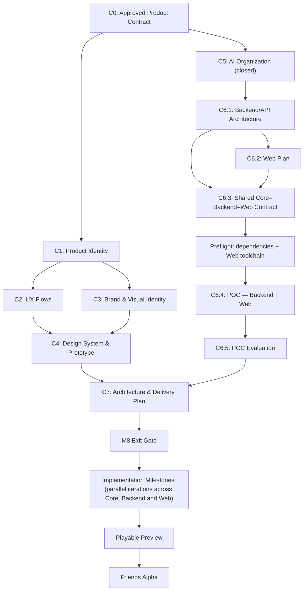

# Go! Poker — Milestone 8 Plan

**Status:** Plan approved in M8 C0. Amended on 2026-11-10 at C5.4 (C5 closed, C6 replanned; see [C6 parallel-development POC](#c6-parallel-development-poc)). Amended on 2026-11-11 at C6.1 (the POC is Backend ∥ Web, with a bounded preflight; see the [C6.1 plan](M8_C6_1_BACKEND_API_PLAN.md)). Cycle status is in `docs/CURRENT_CYCLE.md`.  
**Date:** 2026-11-08  
**Milestone:** M8 — Go! Product & Company Foundation

## Outcome and boundaries

M8 defines the product/design identity, cross-platform experience contracts, AI-native team operating model, a measured parallel-development proof of concept, and technical delivery architecture. **M8 is not the Friends Alpha release.** The next implementation milestones deliver Playable Preview and Friends Alpha in slices of the same product.

The authoritative Friends Alpha scope and decisions are in `docs/product/FRIENDS_ALPHA_PRODUCT_CONTRACT.md`.

## Cycles and deliverables

| Cycle | Purpose | Completion artifact |
|---|---|---|
| C0 | Freeze product behavior, Alpha scope, acceptance and dependency map | Friends Alpha Product Contract + this M8 Plan |
| C1 | Product positioning, audience, core experience and Go! master-brand relationship | `docs/product/PRODUCT_VISION.md` |
| C2 | Lobby, saved table, joining, wallet, seating, game and error/reconnect UX flows | `docs/product/UX_FLOWS.md` |
| C3 | Visual brand directions, logo/wordmark selection, typography and table/motion art direction | `docs/design/BRAND.md` and visual references |
| C4 | Cross-platform design tokens, component states, motion specifications and interactive prototype | `docs/design/DESIGN_SYSTEM.md`, `docs/design/MOTION_CONTRACTS.md`, prototype |
| C5 | AI organization: an Orchestrator and short-lived per-Work-Order Cycle Leads over lanes Core, Backend/API, Design, Org and Meta (Web after C7), with shared Engineer/QA/Reviewer roles; Work Orders, handoffs, contract-first parallelism, escalation and budgets; ownership and closeout tooling (C5.1–C5.4a). Amended 2026-11-10: C5.4b (guard hook) stopped and superseded; C5.5 (Work Order tooling) and C5.6 (activation) not pursued in M8, so multi-lane activation is not a prerequisite for product work | Rules in `docs/ENGINEERING_PROCESS.md`, the lane map `.claude/ownership.json`, ADR 0007; rationale in `docs/company/M8_C5_2_ORGANIZATION_DESIGN.md`; `docs/company/C5_4_ENFORCEMENT_RETROSPECTIVE.md` |
| C6 | Platform architecture, shared contract and parallel-development POC, native-first and manually coordinated, under the technology freeze in `docs/ENGINEERING_PROCESS.md` (C6.1–C6.5, [below](#c6-parallel-development-poc)) | Architecture plan and contract ADRs; POC code merged on `master`; `docs/company/TOOLING_EVALUATION.md` (POC findings) |
| C7 | Integrate product/design/org with identity, wallet, ledger, sessions, the C6 API and Web plans, hosting, security, operational tradeoffs; plan the next parallel iteration across Core, Backend and Web; design persistence and recovery, the table directory and leases, Quick Play and capacity planning ([C6.1 plan](M8_C6_1_BACKEND_API_PLAN.md) §4–§6, §11); keep the contracts consumable by a later Mobile client | Architecture ADRs + next milestone execution plan |

## Dependency graph

C1 unlocks parallel UX (C2) and visual identity (C3). The engineering track (C5, then C6) proceeds independently of visual design. C6.1 replaces the earlier, unscheduled "Parallel Architecture Discovery" track. C6.2 uses the C2–C4 design work available at the time and records what Web still waits on. Only the integrated final architecture/delivery cycle (C7) waits for all inputs.

## C6 parallel-development POC

Approved on 2026-11-10 with the C5.4 transition. The workflow rules are in `docs/ENGINEERING_PROCESS.md` ([Parallel Sessions](../ENGINEERING_PROCESS.md#parallel-sessions-native-single-team-mode)). No autonomous orchestrator, custom guard or Work Order tooling is built for it.

| Part | Purpose | Completion artifact |
| --- | --- | --- |
| C6.1 | Backend/API architecture plan: the Core–Backend boundary (`TableSession` and the engine), the server's shape, transport, serialization of views and commands, and errors. Coordinated with Core, and designed so Web now and Mobile later are both clients of the same API | [C6.1 plan](M8_C6_1_BACKEND_API_PLAN.md) (approved 2026-11-11; C6.1 complete) and [ADR 0008](../adr/0008-fastapi-server-and-single-writer-tables.md) |
| C6.2 | Web plan, coordinated with Backend: client architecture, how it consumes the API, and the design handoff it needs from C2–C4 | Web plan document under `docs/` |
| C6.3 | Shared Core–Backend–Web contract: signatures, wire schema, semantics, errors and versioning, plus the POC's functional slice, the canonical example messages, and its two Briefs (Backend and Web, disjoint paths) | Accepted wire contract ADR 0009 with its example messages; two approved Briefs |
| Preflight | One bounded Small-Change-Path Meta task before C6.4: the server dependencies (`fastapi`, `uvicorn`, `websockets`, dev `httpx`) with Python 3.14 confirmed, and the Web toolchain in `scripts/verify.py` and CI. No ownership-map change | Merged preflight; `VERIFY: PASS` |
| C6.4 | POC iteration 1: Backend (`src/go_poker/server/`, `tests/server/`) and Web (`web/`) in two isolated sessions and worktrees, built against ADR 0009 and integrated on `master`. Core and `app/` are unchanged. Small and local: one process, in memory, private tables only | Two merged PRs, a passing Backend integration test on `master`, and a recorded two-browser demonstration |
| C6.5 | POC evaluation against the success criteria below; keep or adjust the workflow | `docs/company/TOOLING_EVALUATION.md` |

**Bounds.**

- C6.1–C6.3 are documentation-only planning Cycles. Each produces only the documents and ADRs listed above: no scripts, CI, hooks, settings or other tooling changes.
- They plan only what the C6.4 slice and its contract need. Identity, wallet, ledger, hosting and security wait for C7.
- After C6.3 and the preflight, C6.4 is the first Cycle that writes product code: Backend in the Backend lane and Web in `web/`. Each Brief declares its paths.

**Success criteria.** The targets are proposals, confirmed or changed when the C6.3 Briefs are approved. Usage percentages are recorded per five-hour or weekly window, as read from the app, and are never summed across windows.

| Dimension | Measure | Proposed target |
| --- | --- | --- |
| Contract stability | superseding contract ADRs and contract clarifications during C6.4 | no superseding ADR; at most one clarification, with no signature change |
| Functional integration | an integration test on `master` drives the Backend through the real `TableSession` and engine, with no doubles reachable from production code; Web passes its tests against the ADR 0009 example messages; a two-browser demonstration plays hands through the real server | passes; `quality` and `ownership` green on both PRs |
| Tests | each Cycle's Definition of Done; `VERIFY: PASS` in each worktree and on `master` after both merges | all pass |
| Path isolation | files changed outside each Brief's declared paths | none |
| Elapsed time | wall-clock time from the first Brief approval to the second merge, against the sum of both Cycles' own elapsed times | at most 75% of the sum |
| Session context | peak context per role and session (`scripts/usage_report.py`) | Engineer and QA under the 150k warning threshold; no session over 300k |
| Usage | five-hour and weekly percentages at the start and end of each window; model calls per session | no window reaches its limit during C6.4 |
| Rework | fix rounds per Cycle, and rework caused by the other session's work | at most two fix rounds per Cycle; no cross-session rework beyond the pre-merge update |
| Owner intervention | each intervention, labelled planned (Brief approval, worktree setup, merge) or unplanned (unblocking, clarification, recovery) | at most two unplanned per Cycle |

## M8 exit gates

1. Product vision, scope and approved contract provide sufficient detail to develop without recurrent product reinvention.
2. Lobby, table and settings UX prototype covers 2–9 seats, interaction states, error/reconnect, wallet and account flows.
3. Brand, design-system tokens, reusable UI component definitions and cross-platform motion contracts are approved with reference imagery/prototypes.
4. AI team roles, ownership, handoffs, autonomy/escalation rules, context strategy and budget controls are specified.
5. A real feature-sized task runs as two parallel Cycles, Backend and Web, in separate sessions and worktrees against a shared contract. Each goes through Engineer → QA → Reviewer, and both integrate on `master`. The C6 success criteria are measured and documented, and the native workflow is kept or adjusted based on the results (amended 2026-11-10; Backend and Web from 2026-11-11, C6.1 E9-A).
6. Identity, Wallet, Ledger, Table/Session lifecycle and Core/API/client contract boundaries are reviewed, including recovery and security threat scenarios.
7. Release architecture, test plan, performance targets, deployment/recovery path, implementation milestones, dependencies and owners are explicit.
8. A NotebookLM Decision Pack accurately reflects approved decisions, with final sources suitable for explanatory video scripts.

## Operating rhythm / repository handoff

- After each cycle: review deliverable → approve product/architecture choices → commit authoritative files → create NotebookLM source summary (not a substitute for repo docs) → update plan/dependencies.
- `AGENTS.md`/`CLAUDE.md` should link to relevant docs instead of duplicating them.
- Avoid creating empty placeholders for future-cycle docs. Create each document upon completing the relevant cycle.
- For a future feature request, Lead drafts impact/ownership/contract/QA matrix; existing design language and interfaces guide implementation. Escalate genuinely new product decisions.
- M8 C0 is a documentation/product-planning checkpoint, not a claim that wallets, Web or sessions are implemented or verified.

## NotebookLM plan

Use a dedicated project-video notebook. Start with the C0 product contract and M8 plan (only approved product decisions). Later add final C1–C7 outputs, selected architecture diagrams, visual references/screenshots, prototype captures and test/evaluation findings. Videos are in Hebrew, with natural English engineering/poker terminology and a calm male narrator when controllable. Distinguish future plans from shipped features in every overview.

## Next action

The active Cycle and each Cycle's status are in `docs/CURRENT_CYCLE.md`.
